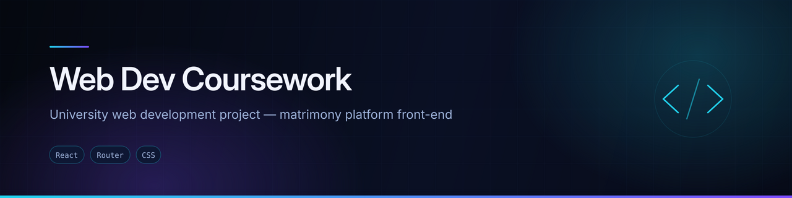
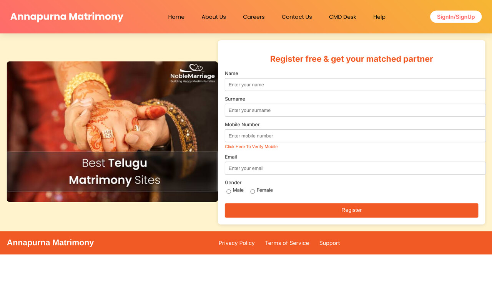

<div align="center">
  
</div>

<div align="center">


</div>

## Overview

University web development coursework: the front-end for **Annapurna Matrimony**, a matrimony platform with registration, sign-in and supporting company pages.

The brief was to build a multi-page React application with client-side routing and a consistent layout, without a backend. This repository is the submitted result, kept as a record of the coursework rather than presented as production work.

## Preview



<sub>Screenshot captured from a local production build of this repository.</sub>

## Features

- **Seven routes** — `/`, `/signinsignup`, `/aboutus`, `/carrers`, `/contactus`, `/CMDdesk`, `/help`
- **Sign-in / sign-up** screen
- **Company pages** — about, careers, CMD's desk, help, contact
- **Shared navbar and footer** across every route
- **Responsive** layout

## Tech stack

| Layer | Technology |
|---|---|
| Framework | React (Create React App) |
| Routing | React Router DOM — 7 routes |
| Styling | Hand-written CSS per component |

The dependency list here is deliberately minimal — React, React DOM, React Router and the Create React App toolchain. Nothing else is installed, and nothing installed goes unused.

## Project structure

```
src/
├── components/
│   ├── Project/     Landing page composition
│   ├── navbar/, footer/
│   ├── Hero/
│   └── Login/       Sign-in and sign-up
├── pages/           AboutUs, Carrers, ContactUs, CMDdesk, Help
└── App.js           7 route definitions
```

## Running locally

```bash
git clone https://github.com/AJAY2043/webdev-jntu.git
cd webdev-jntu
npm install
npm start
```

```bash
npm run build     # production build into ./build — builds cleanly
```

## Future improvements

If this were taken past coursework:

- Set a real page title and favicon — `public/index.html` still says `React App`
- Add a 404 route
- Give the registration and sign-in forms real validation and a backend
- Correct the spelling of `/carrers`

## Related

`AJAY2043/vijayareddy-website` is the client-facing version of this same application.

## Author

**Ajay Krishna Reddy Bhavanam** — Melbourne, Australia
[LinkedIn](https://linkedin.com/in/ajay-krishna-reddy) · [GitHub](https://github.com/AJAY2043)
